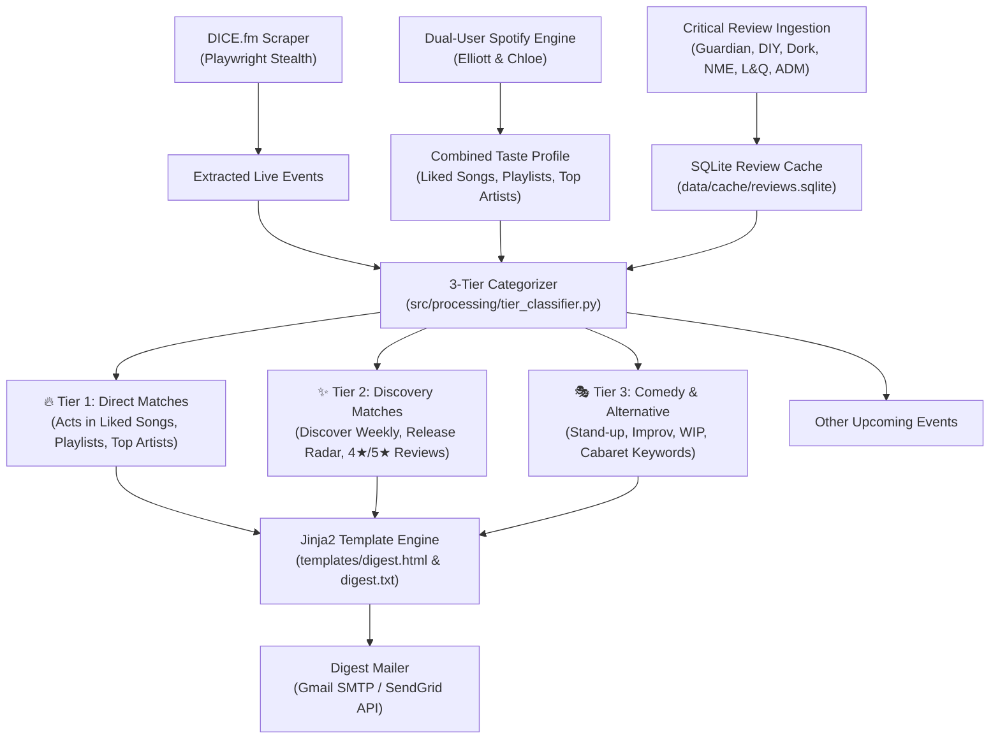

# Live Curator Engine // East London


A modular, automated intelligence engine that discovers upcoming live music and comedy events in Dalston and wider East London from **DICE.fm**, cross-references performers against **Elliott & Chloe's Spotify libraries** and **UK music critical reviews**, and dispatches a responsive HTML email digest on the 1st of every month.

---

## 🎯 Target Seed Venues (Configured in `config/venues.yaml`)

| Venue | Area | Platform | Slug / Verified ID |
|---|---|---|---|
| **The Shacklewell Arms** | Dalston | DICE | `the-shacklewell-arms-z82z` |
| **MOTH Club** | Hackney Central | DICE | `moth-club-43ox` |
| **Oslo Hackney** | Hackney Central | DICE | `oslo-hackney-je6z` |
| **The Waiting Room** | Stoke Newington | DICE | `the-waiting-room-jxea` |
| **The Victoria** | Dalston | DICE | `the-victoria-j5wd` |
| **The George Tavern** | Shadwell / Whitechapel | DICE | `the-george-tavern-l89p` |
| **Hand of Glory** | Hackney Central | DICE | `hand-of-glory-82e7` |
| **EartH (Evolutionary Arts Hackney)** | Dalston | DICE | `earth-76a7` |
| **Next Door Records Two** | Stoke Newington | DICE | `next-door-records-two-v2z9` |

---

## 🧭 3-Tier Categorization Architecture



1. **Tier 1 (Direct Matches — Must-See Live):**
   - DICE acts explicitly appearing in Elliott's or Chloe's Spotify Saved Tracks ("Liked Songs"), user-created playlists, or Top Artists.
   - Tagged in the digest with clear indicators (e.g. `👨‍💻 In Elliott's Playlists`, `👩‍🎨 In Chloe's Liked Songs`).
2. **Tier 2 (Discovery Matches — Algorithmic & Critical Picks):**
   - DICE acts matching Spotify algorithmic discovery (Discover Weekly, Release Radar) **OR** holding $\ge 4\star$ reviews or $\ge 7.5/10$ aggregate ratings in British music publications (**The Guardian**, **NME**, **DIY Magazine**, **Dork**, **Loud & Quiet**, **AnyDecentMusic?**).
3. **Tier 3 (Comedy & Alternative):**
   - Events matching comedy, stand-up, improv, work-in-progress (WIP), and cabaret keywords. Filtered into a dedicated section of the monthly digest.

---

## 🚀 Quick Start

### 1. Environment Setup

Ensure Python 3.10+ is installed on your Mac:

```bash
# Clone and enter directory
cd "Live Curator"

# Create virtual environment and install dependencies
python3 -m venv .venv
source .venv/bin/activate
pip install -r requirements.txt

# Install Playwright browser binaries
playwright install chromium
```

### 2. Configure Environment (`.env`)

Copy `.env.example` to `.env`:

```bash
cp .env.example .env
```

Ensure your `.env` contains:
```env
# Spotify Developer Credentials
SPOTIFY_CLIENT_ID=your_spotify_client_id
SPOTIFY_CLIENT_SECRET=your_spotify_client_secret
SPOTIFY_REDIRECT_URI=http://127.0.0.1:8888/callback

# Captured OAuth Refresh Tokens
ELLIOTT_SPOTIFY_REFRESH_TOKEN=...
CHLOE_SPOTIFY_REFRESH_TOKEN=...

# Email Delivery (Gmail SMTP or SendGrid)
GMAIL_USER=elliottcallender@gmail.com
GMAIL_APP_PASSWORD=your_16_char_google_app_password
DIGEST_RECIPIENTS=elliottcallender@gmail.com,chloe@example.com

# Optional APIs
GUARDIAN_API_KEY=your_guardian_key_if_available
```

### 3. Connect Spotify Accounts

To authorize or refresh either account:

```bash
# Authenticate Elliott
.venv/bin/python3 scripts/auth_spotify.py --user Elliott

# Authenticate Chloe
.venv/bin/python3 scripts/auth_spotify.py --user Chloe
```

> **Note for Chloe's account in Spotify Dev Mode:**
> In Spotify Developer Dashboard, apps in "Development Mode" require non-creator accounts to be added to **Dashboard → Live Curator → User Management** before querying personal library endpoints.

---

## 💻 Running the Engine

### Generate HTML Preview & Test (Dry Run)

Run the full end-to-end pipeline in dry-run mode and open the responsive HTML email in your browser:

```bash
# Preview across a single venue (e.g. MOTH Club or The Shacklewell Arms)
.venv/bin/python3 main.py --venue "MOTH Club" --preview-html

# Preview all 9 seed venues across East London
.venv/bin/python3 main.py --preview-html
```

### Force Refresh Critical Music Reviews

```bash
.venv/bin/python3 main.py --refresh-reviews --preview-html
```

### Dispatch Real Email Digest

```bash
.venv/bin/python3 main.py --send-email
```

---

## ⏰ Automated Monthly Scheduling on macOS

The engine is designed to dispatch automatically on the **1st of every month at 09:00 AM**.

On macOS, running as a **launchd service** is strongly recommended over standard `cron` because `launchd` executes missed jobs as soon as your Mac wakes up from sleep:

```bash
# Generate the launchd plist at ~/Library/LaunchAgents/com.livecurator.monthly.plist
./scripts/setup_cron.sh

# Load and activate the monthly service
launchctl load ~/Library/LaunchAgents/com.livecurator.monthly.plist
```

To view logs from automated runs:
```bash
tail -f data/logs/monthly_digest.log
```

---

## 🧪 Automated Test Suite

Run the full pytest suite (47 unit and integration tests covering scrapers, normalizer, Spotify engine, review cache, classifier, templates, and mailer):

```bash
.venv/bin/pytest tests/ -v
```

```text
tests/test_config.py::test_load_config_venues PASSED
tests/test_config.py::test_load_settings PASSED
tests/test_delivery.py::TestTemplateEngine::test_render_html_contains_critical_data PASSED
tests/test_delivery.py::TestTemplateEngine::test_render_text_contains_critical_data PASSED
tests/test_delivery.py::TestDigestMailer::test_build_subject_tier_1_highlight PASSED
tests/test_delivery.py::TestDigestMailer::test_dry_run_dispatch PASSED
tests/test_delivery.py::TestDigestMailer::test_gmail_smtp_dispatch_success PASSED
tests/test_dice_scraper.py::test_parse_event_from_dict_success PASSED
tests/test_normalizer.py::TestArtistNormalization PASSED
tests/test_normalizer.py::TestLineupSplitting PASSED
tests/test_review_parser.py::TestReviewDatabase PASSED
tests/test_spotify_engine.py::test_refresh_access_token_success PASSED
tests/test_tier_classifier.py::TestTierClassifier PASSED
============================== 47 passed in 0.40s ==============================
```

---

## 📁 Repository Structure

```
├── main.py                     # Master Orchestration CLI
├── config/
│   ├── venues.yaml             # External seed venue definitions (9 venues)
│   └── settings.yaml           # Scraping, review thresholds, and comedy keywords
├── templates/
│   ├── digest.html             # Responsive HTML email template (dark aesthetic)
│   └── digest.txt              # Plain-text email fallback
├── src/
│   ├── core/
│   │   ├── config.py           # Configuration and secrets loader
│   │   ├── models.py           # Domain entities (Event, Venue, Review, Digest)
│   │   └── normalizer.py       # Act name normalization and lineup splitting
│   ├── ingestion/
│   │   ├── dice_scraper.py     # Headless Playwright scraper with Turnstile bypass
│   │   ├── spotify_engine.py   # Dual-user token refresh & playlist ingestion
│   │   └── review_parser.py    # UK music review scraper & SQLite cache
│   ├── processing/
│   │   └── tier_classifier.py  # 3-tier categorization & match rationale engine
│   └── delivery/
│       ├── template_engine.py  # Jinja2 renderer for HTML & plain text
│       └── digest_mailer.py    # Gmail SMTP & SendGrid email dispatcher
├── scripts/
│   ├── auth_spotify.py         # Interactive Spotify OAuth authorization tool
│   ├── test_dice_scraper.py    # Standalone DICE venue testing tool
│   ├── test_reviews.py         # Standalone review scraper & cache test
│   └── setup_cron.sh           # macOS launchd plist and crontab installer
├── tests/                      # 47 unit & integration tests
└── data/
    └── cache/
        └── reviews.sqlite      # Persistent SQLite cache of critical reviews
```
