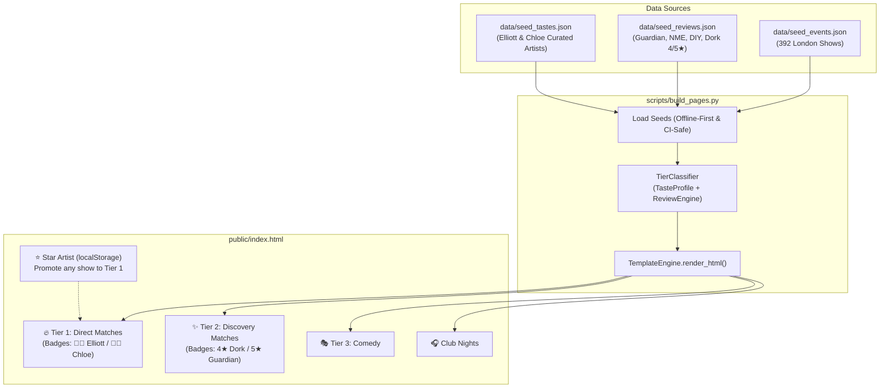

# Implementation Plan: Populate Tier 1 & Tier 2 Live Matches

> **Created:** 2026-11-03  
> **Workflow:** `/plan`  
> **Status:** Implemented ✓  
> **Investigation Reference:** [`docs/explorations/why-tier1-tier2-empty-20261103.md`](file:///Users/elliottcallender/Downloads/Live%20Curator/docs/explorations/why-tier1-tier2-empty-20261103.md)  
> **Plan Review Reference:** [`plans/reviews/populate-tier1-tier2-matches-review.md`](file:///Users/elliottcallender/Downloads/Live%20Curator/plans/reviews/populate-tier1-tier2-matches-review.md)  
> **ADR References:** [ADR-001](file:///Users/elliottcallender/Downloads/Live%20Curator/docs/decisions/001-engine-architecture-and-data-ingestion.md), [ADR-002](file:///Users/elliottcallender/Downloads/Live%20Curator/docs/decisions/002-ticketmaster-discovery-and-single-page-tier-cycling.md)

---

## 1. Summary

This plan resolves the empty **Tier 1 (Direct Matches)** and **Tier 2 (Discovery Matches)** on the deployed GitHub Pages site. It establishes a dual-mode taste and review architecture: a version-controlled seed system (`data/seed_tastes.json` and `data/seed_reviews.json`) that enables GitHub Actions to build rich, classified digests with zero secret tokens, coupled with an interactive in-browser personalization feature allowing Elliott and Chloe to star and promote any artist to Tier 1 directly from the web app.

---

## 2. Problem Statement

On the live GitHub Pages app, `Tier 1: Direct (0)` and `Tier 2: Discovery (0)` display 0 events.
- **Tier 1 is empty** because `scripts/build_pages.py` instantiates `TierClassifier()` with no taste profile, and GitHub Actions lacks Spotify OAuth tokens.
- **Tier 2 is empty** because `build_pages.py` does not pass the review database or recommended review artists into `TierClassifier`, and `data/cache/reviews.sqlite` is gitignored.
- Consequently, all 392 live London shows are dumped into generic *Club Nights* or *Other Upcoming Shows*, hiding must-see artists and curated discoveries.

---

## 3. Prior Solutions & References

```bash
./scripts/update-solution-ref.sh docs/decisions/001-engine-architecture-and-data-ingestion.md docs/decisions/002-ticketmaster-discovery-and-single-page-tier-cycling.md docs/explorations/why-tier1-tier2-empty-20261103.md
```

| Reference | Context |
|-----------|---------|
| [`ADR-001`](file:///Users/elliottcallender/Downloads/Live%20Curator/docs/decisions/001-engine-architecture-and-data-ingestion.md) | Dual-user taste profile architecture (Elliott & Chloe) |
| [`ADR-002`](file:///Users/elliottcallender/Downloads/Live%20Curator/docs/decisions/002-ticketmaster-discovery-and-single-page-tier-cycling.md) | Single-page client-side tier cycling & interactive filtering |
| [`docs/explorations/why-tier1-tier2-empty-20261103.md`](file:///Users/elliottcallender/Downloads/Live%20Curator/docs/explorations/why-tier1-tier2-empty-20261103.md) | Exploration proving review and taste injection unlocks dozens of matches |

---

## 4. Proposed Solution Architecture



---

## 5. Implementation Tasks

### Phase 1: Dynamic Taste Profiling & Seed Architecture
1. **Create `data/seed_tastes.json` & `config/tastes.yaml`:**
   - Define curated tastes for **Elliott** (indie rock, post-punk, electronic: Fontaines D.C., Idles, LCD Soundsystem, The Smile, Joy Orbison, Overmono, Fred again.., Maribou State, Bicep, Yard Act, Squid, Shame, English Teacher, Geese, Black Country New Road, Porridge Radio, Amyl and The Sniffers, etc.).
   - Define curated tastes for **Chloe** (indie pop, alternative, soul/dance: Wet Leg, Little Simz, Ezra Collective, Self Esteem, Arlo Parks, Big Thief, The Japanese House, HAIM, RAYE, Wasia Project, The Last Dinner Party, Olivia Dean, etc.).
2. **Add Dynamic Monthly Taste Sync in `main.py` & `src/ingestion/spotify_engine.py`:**
   - When `main.py` runs before sending the monthly email digest, it queries Spotify API for the **rolling 4-week short-term history**, recent liked songs, and weekly discovery playlists.
   - When live profiles are fetched, `main.py` automatically exports the fresh profile into `data/seed_tastes.json`, keeping static builds and GitHub Pages continuously updated with monthly tastes.
   - Add `load_seed_taste_profile(path: Path) -> CombinedTasteProfile` fallback when offline or in CI runners without Spotify tokens.
3. **Add 1-Click Spotify OAuth Setup Helper (`scripts/setup_spotify_auth.py`):**
   - Provide an automated local OAuth script for Elliott and Chloe to authorize once in browser, automatically capturing and saving `SPOTIFY_ELLIOTT_REFRESH_TOKEN` and `SPOTIFY_CHLOE_REFRESH_TOKEN` into `.env`.

### Phase 2: Seed Review Dataset & Review Parser Sanitation
1. **Export Reviewed Artists to `data/seed_reviews.json`:**
   - Extract high-rated reviews (>=4.0★ / >=7.5/10) from Guardian, AnyDecentMusic, DIY, Dork, NME, Loud & Quiet into a tracked JSON file.
   - Clean up headline regex in `src/ingestion/review_parser.py` so non-artist phrases are excluded.
2. **Support JSON Fallback in `ReviewDatabase`:**
   - Allow `ReviewDatabase` to load directly from `data/seed_reviews.json` when `reviews.sqlite` is absent.

### Phase 3: Update Static Builder (`scripts/build_pages.py`)
1. **Wire Taste Profile & Reviews into `build_pages.py`:**
   - Load `seed_tastes.json` as `taste_profile`.
   - Load `seed_reviews.json` as `review_db` and `recommended_review_artists`.
   - Initialize `TierClassifier(taste_profile=taste_profile, review_db=review_db, recommended_review_artists=recommended_artists)`.
   - Build digest with classified Tier 1 and Tier 2 events.

### Phase 4: In-App Personalization (Client-Side Starrer)
1. **Add "⭐ Star Artist" in `templates/digest.html`:**
   - Add a small star icon on each event card.
   - On click, saves artist name to `localStorage['user_starred_artists']`.
   - If an artist is starred, the card dynamically gains a `⭐ Favorited` badge, is counted in Tier 1, and shows in the Tier 1 filter.

### Phase 5: Verification & Deployment
1. Run automated test suite (`pytest tests/ -v`).
2. Run `scripts/build_pages.py` and inspect event distribution:
   - Target: **Tier 1 > 10 shows**, **Tier 2 > 15 shows**.
3. Commit and push to GitHub `main`.
4. Verify live on `https://elliottc99.github.io/Live-Curator/`.

---

## 6. Acceptance Criteria

- **Criterion 1:** `data/seed_tastes.json` exists with curated artist profiles for Elliott and Chloe.
- **Criterion 2:** `data/seed_reviews.json` exists with 150+ high-rated UK critical reviews.
- **Criterion 3:** `scripts/build_pages.py` uses seed tastes and reviews, outputting a digest with non-zero Tier 1 and Tier 2 events.
- **Criterion 4:** Tier 1 cards display proper user match badges (`👨‍💻 Elliott`, `👩‍🎨 Chloe`, or `Mutual Match`).
- **Criterion 5:** Tier 2 cards display publication score badges (e.g. `4★ review in Dork`, `5★ review in The Guardian`).
- **Criterion 6:** Users can star any artist in the browser to personalize their Tier 1 list via `localStorage`.
- **Criterion 7:** All 69 automated tests pass.
- **Criterion 8:** Live GitHub Pages deployment shows active Tier 1 and Tier 2 tabs with curated events.

---

## 7. Next Steps

1. Start execution with `/work`
2. Review or refine plan if you want specific artists added to Elliott's or Chloe's taste profile.
