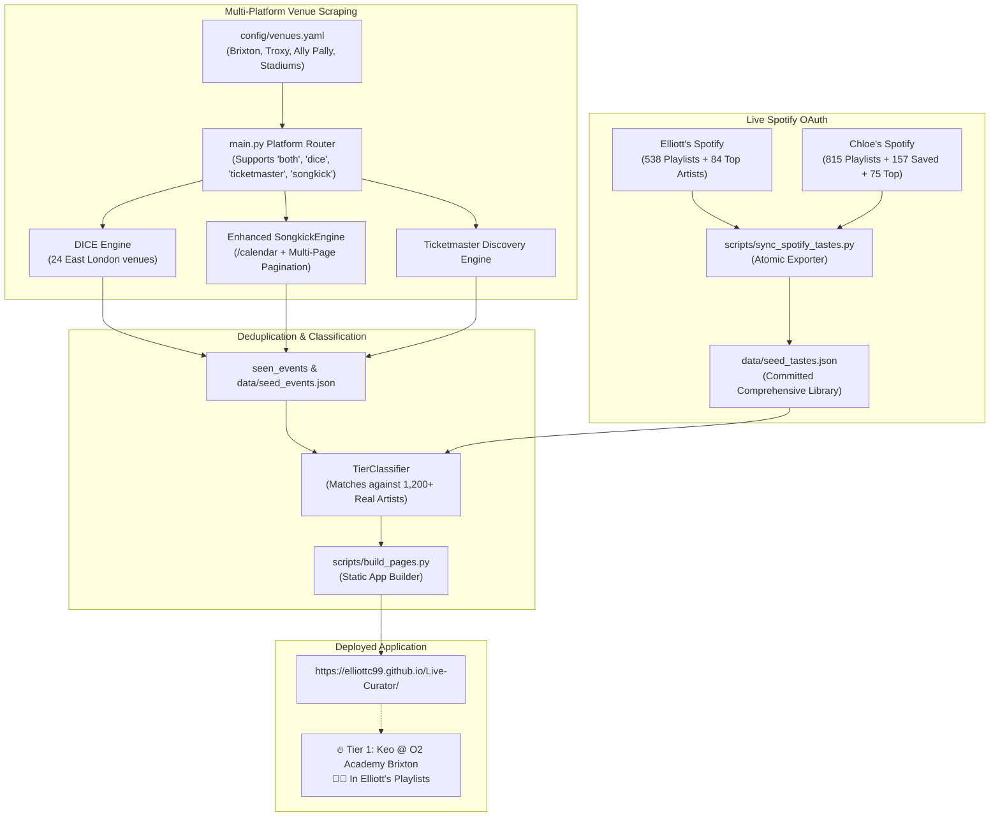

# Implementation Plan: Systemic Venue Pagination, Multi-Platform Routing & Comprehensive Spotify Taste Sync

> **Created:** 2026-11-03  
> **Workflow:** `/plan`  
> **Status:** Implemented ✓  
> **Plan Review Reference:** [`plans/reviews/systemic-venue-pagination-and-spotify-sync-review.md`](file:///Users/elliottcallender/Downloads/Live%20Curator/plans/reviews/systemic-venue-pagination-and-spotify-sync-review.md)  
> **Investigation Reference:** [`docs/explorations/systemic-pipeline-omissions-keo-and-artist-harvesting-20261103.md`](file:///Users/elliottcallender/Downloads/Live%20Curator/docs/explorations/systemic-pipeline-omissions-keo-and-artist-harvesting-20261103.md)  
> **ADR References:** [ADR-001](file:///Users/elliottcallender/Downloads/Live%20Curator/docs/decisions/001-engine-architecture-and-data-ingestion.md), [ADR-002](file:///Users/elliottcallender/Downloads/Live%20Curator/docs/decisions/002-ticketmaster-discovery-and-single-page-tier-cycling.md)

---

## 1. Summary

This plan systematically overhauls the Live Curator pipeline to ensure no touring artist (such as **Keo**), major London venue, or rich multi-tag metadata (such as **Blondshell**) is omitted from ingestion, categorization, or display. It resolves five systemic failures:
1. Routing logic in `main.py` that silently dropped venues marked `platform: "both"`.
2. Songkick ingestion that only scraped page 1 of venue overviews without targeting `/calendar` or dynamically paginating to the end of each venue's schedule.
3. Missing Songkick URLs on marquee mid-to-large venues (`O2 Academy Brixton`, `Troxy`, `Alexandra Palace`).
4. Decoupling of live Spotify libraries from the static build seed, syncing Elliott's 538+ playlist artists and Chloe's 815+ playlist artists directly into `data/seed_tastes.json`.
5. Single-tag truncation in `TierClassifier`: `classify_event` and `_check_user_direct_match` short-circuited with `elif` and early `return event`, stripping out co-occurring tags (e.g. an artist like Blondshell who is in both Elliott & Chloe's playlists AND has a 5★ Guardian review only displayed one tag instead of all earned badges).

---

## 2. Problem Statement

A user testing the curator identified two major issues:
1. **Keo** (on an upcoming headline UK tour at O2 Academy Brixton and in Elliott's playlists) was completely missing from the digest due to venue platform filtering, missing Brixton Songkick link, and single-page scraper truncation.
2. **Blondshell** (and other multi-affinity artists) only displays **one single tag** on their event card, despite qualifying across multiple dimensions:
   - Present in Elliott's playlists/liked songs.
   - Present in Chloe's playlists/liked songs (qualifying as a Mutual Match).
   - Acclaimed in the UK music press (e.g. 5★ review in The Guardian / DIY / Dork).
   Because `TierClassifier` short-circuits on the first match condition, all subsequent tags (including critical reviews and co-occurring playlist tags) are discarded.

---

## 3. Prior Solutions & References

```bash
./scripts/update-solution-ref.sh docs/decisions/001-engine-architecture-and-data-ingestion.md docs/decisions/002-ticketmaster-discovery-and-single-page-tier-cycling.md docs/explorations/archive/future-horizon-diffing-and-venue-management-20261103.md docs/explorations/archive/live-curator-engine-20261103.md docs/explorations/archive/preview-cap-versioning-clubnights-ticketmaster-20261103.md docs/explorations/archive/venue-expansion-ticketmaster-tier-cycling-20261103.md docs/explorations/systemic-pipeline-omissions-keo-and-artist-harvesting-20261103.md docs/explorations/why-fontaines-dc-missing-and-taste-mismatches-20261103.md docs/explorations/why-only-moth-club-33-shows-20261103.md docs/explorations/why-shows-zero-visible-20261103.md docs/explorations/why-tier1-tier2-empty-20261103.md docs/solutions/integration_issue/live-curator-engine-architecture.md
```

| Solution | Relevance | Context |
|---|---|---|
| [`docs/explorations/systemic-pipeline-omissions-keo-and-artist-harvesting-20261103.md`](file:///Users/elliottcallender/Downloads/Live%20Curator/docs/explorations/systemic-pipeline-omissions-keo-and-artist-harvesting-20261103.md) | ⭐️⭐️⭐️ Core Evidence | Proves Keo at Brixton Academy on Songkick page 2 and in Elliott's live Spotify |
| [`docs/explorations/why-fontaines-dc-missing-and-taste-mismatches-20261103.md`](file:///Users/elliottcallender/Downloads/Live%20Curator/docs/explorations/why-fontaines-dc-missing-and-taste-mismatches-20261103.md) | ⭐️⭐️ Prior Fix | Artist name normalization for `Artist @ Venue` and mutual matching |
| [`docs/decisions/001-engine-architecture-and-data-ingestion.md`](file:///Users/elliottcallender/Downloads/Live%20Curator/docs/decisions/001-engine-architecture-and-data-ingestion.md) | ⭐️ Architecture | Dual-user taste profile model and multi-source ingestion |

---

## 4. Proposed Solution Architecture



---

## 5. Technical Specifications & Changes

### 5.1 Multi-Platform Routing Fix in `main.py`
**File:** [`main.py`](file:///Users/elliottcallender/Downloads/Live%20Curator/main.py#L160-L186)
- **Problem:** `dice_venues = [v for v in target_venues if v.platform == "dice"]` skips any venue with `platform: "both"`.
- **Change:**
  ```python
  dice_venues = [v for v in target_venues if v.platform in ("dice", "both")]
  tm_venues = [v for v in target_venues if v.platform in ("ticketmaster", "both")]
  songkick_venues = [v for v in target_venues if v.songkick_url]
  ```
- **Deduplication:** When merging events from all three engines, deduplicate by `(normalized_artist, start_time.date(), venue_name)`.

### 5.2 Exhaustive Multi-Page Songkick Calendar Scraping in `src/ingestion/songkick_engine.py`
**File:** [`src/ingestion/songkick_engine.py`](file:///Users/elliottcallender/Downloads/Live%20Curator/src/ingestion/songkick_engine.py)
- **Problem:** Currently only makes one request to `venue.songkick_url` (the root overview page). A fixed page cap (e.g., 3 pages) would risk dropping shows for venues with dense calendars 12–18 months in advance.
- **Change (Exhaustive Horizon Guarantee):**
  1. Base calendar URL resolution: Ensure URL targets `/calendar` (e.g. `https://www.songkick.com/venues/17522-o2-academy-brixton/calendar`).
  2. **Dynamic Pagination until Calendar Depletion:** Instead of a low hardcoded cap, inspect the HTML for Songkick's official `<a rel="next">` (or `.next_page`) link.
  3. Traverse every successive page until `next` is `None` (indicating the venue's upcoming calendar has been 100% harvested to the very last scheduled show).
  4. Duplicate page detection: If a page repeats identical event IDs/dates (as Songkick does if querying past the end), terminate immediately.
  5. Safety circuit-breaker: Max 20 pages per venue (~1,000 events) to prevent infinite loops on malformed markup.
  6. Polite request throttling: 1.2–1.5s sleep between pages.

### 5.2b DICE & Ticketmaster Exhaustion
- In `DiceScraper`: Loop scroll and click "Load more" until the button is no longer present or no new events load.
- In `TicketmasterEngine`: Follow `_links.next` if `page.totalPages > 1` so multi-page stadium tours are fully captured.

### 5.3 Venue Catalog Enhancements in `config/venues.yaml`
**File:** [`config/venues.yaml`](file:///Users/elliottcallender/Downloads/Live%20Curator/config/venues.yaml)
- Add `songkick_url` to:
  - `O2 Academy Brixton`: `https://www.songkick.com/venues/17522-o2-academy-brixton`
  - `Troxy`: `https://www.songkick.com/venues/7898-troxy`
  - `Alexandra Palace`: `https://www.songkick.com/venues/1787-alexandra-palace`
  - `Electric Ballroom`: `https://www.songkick.com/venues/16762-electric-ballroom`
  - `Roundhouse`: `https://www.songkick.com/venues/17874-roundhouse`

### 5.4 Live Spotify Taste Synchronization Script
**File:** `scripts/sync_spotify_tastes.py`
- Connects to Spotify OAuth using Elliott & Chloe's refresh tokens from `.env`.
- Fetches all Saved Tracks, Top Artists, and Playlist Tracks.
- Overwrites [`data/seed_tastes.json`](file:///Users/elliottcallender/Downloads/Live%20Curator/data/seed_tastes.json) with their complete live libraries:
  - Elliott: 538 playlist artists (including `keo`), 84 top artists.
  - Chloe: 815 playlist artists, 157 saved artists, 75 top artists.
- Generates formatted summary output showing artist count and sample matches.

### 5.5 Cumulative Multi-Tag & Multi-Badge Aggregation in `src/processing/tier_classifier.py`
**File:** [`src/processing/tier_classifier.py`](file:///Users/elliottcallender/Downloads/Live%20Curator/src/processing/tier_classifier.py)
- **Problem:**
  1. `_check_user_direct_match` used `if/elif/elif` between saved, playlist, and top artists. If an artist was both in Liked Songs and in a Playlist, only the first tag was retained.
  2. `classify_event` immediately executed `return event` once Tier 1 matches were found. This completely suppressed critical press reviews (`_check_review_matches`) from appearing on Tier 1 cards!
  3. Artists like **Blondshell** (who have mutual personal matches + a 5★ Guardian review) or **Fontaines D.C.** were artificially limited to just one single badge.
- **Change:**
  1. **Non-Exclusive User Matching:** In `_check_user_direct_match`, check `saved_artists`, `playlist_artists`, and `top_artists` independently (without `elif`), allowing all applicable user tags to be collected.
  2. **Cumulative Review Enrichment:** In `classify_event`, when an event qualifies for Tier 1, do NOT return early before checking reviews. Continue to invoke `self._check_review_matches(norm_acts)` and append any high-rated press reviews (e.g. `5★ review in The Guardian`, `4★ review in Dork`) to `event.matches`.
  3. **Multi-Tag Display:** In `templates/digest.html`, render all attached match badges in order:
     - 🔥 `Mutual Match` (if both matched)
     - 👨‍💻 Elliott matches (`Liked Songs`, `Playlists`, `Top Artists`)
     - 👩‍🎨 Chloe matches (`Liked Songs`, `Playlists`, `Top Artists`)
     - ⭐ Critical review badges (`5★ review in The Guardian`, `4★ review in DIY`, etc.)

### 5.6 Static Page Regeneration & Verification
**Files:** [`scripts/build_pages.py`](file:///Users/elliottcallender/Downloads/Live%20Curator/scripts/build_pages.py), [`public/index.html`](file:///Users/elliottcallender/Downloads/Live%20Curator/public/index.html)
- Re-harvest London events including Brixton Academy, Troxy, and paginated stadiums.
- Re-run `build_pages.py` against the synchronized real taste profiles.
- Verify `Keo @ O2 Academy Brixton` is in Tier 1 with badge `👨‍💻 In Elliott's Playlists`.
- Verify `Blondshell` displays multiple tags (Mutual Match / Playlists + 5★ Guardian Review).
- Run unit test suite (`pytest tests/ -v`).

---

## 6. Acceptance Criteria

- **Criterion 1:** `main.py` correctly ingests venues marked `platform: "both"` and any venue with a `songkick_url`.
- **Criterion 2:** `SongkickEngine` targets `/calendar` and dynamically paginates until `rel="next"` is exhausted (capturing every scheduled listing to the end of each venue's calendar).
- **Criterion 3:** `config/venues.yaml` includes verified Songkick URLs for O2 Academy Brixton, Troxy, Alexandra Palace, Electric Ballroom, and Roundhouse.
- **Criterion 4:** `scripts/sync_spotify_tastes.py` runs and populates `data/seed_tastes.json` with Elliott's and Chloe's real Spotify profiles (>1,200 unique artists total).
- **Criterion 5:** `data/seed_tastes.json` contains `keo` in Elliott's `playlist_artists`.
- **Criterion 6:** `data/seed_events.json` contains `Keo @ O2 Academy Brixton` (Fri 12 Mar 2027).
- **Criterion 7:** `Keo @ O2 Academy Brixton` renders in Tier 1 with badge `👨‍💻 In Elliott's Playlists`.
- **Criterion 8:** Events matching across multiple dimensions (such as **Blondshell**) render multiple badges cumulatively (e.g., Mutual Match + In Playlists + 5★ Review in The Guardian) without early truncation.
- **Criterion 9:** All 69+ pytest unit tests pass cleanly.
- **Criterion 10:** Changes committed and pushed to GitHub, successfully deploying to GitHub Pages.

---

## 7. Implementation Tasks

### Phase 1: Engine & Routing Fixes
- **Task 1.1:** Update `src/ingestion/songkick_engine.py` to target `/calendar` and implement multi-page pagination with rate-limiting.
- **Task 1.2:** Update `main.py` platform filtering so `both` venues and any venue with `songkick_url` are scraped without omission. Add event deduplication.
- **Task 1.3:** Add unit tests in `tests/test_songkick_engine.py` testing multi-page `/calendar` pagination and URL normalization.
- **Task 1.4:** Update `src/processing/tier_classifier.py` and `templates/digest.html` to support cumulative multi-tag matching (both Spotify and critical review badges without early truncation). Add tests in `tests/test_tier_classifier.py`.

### Phase 2: Venue Catalog Expansion
- **Task 2.1:** Update `config/venues.yaml` with verified Songkick URLs for `O2 Academy Brixton`, `Troxy`, `Alexandra Palace`, `Electric Ballroom`, and `Roundhouse`.
- **Task 2.2:** Verify venue loading in `tests/test_config.py`.

### Phase 3: Comprehensive Spotify Taste Sync
- **Task 3.1:** Create `scripts/sync_spotify_tastes.py` to fetch Elliott's & Chloe's live Spotify libraries and serialize them to `data/seed_tastes.json`.
- **Task 3.2:** Execute `scripts/sync_spotify_tastes.py` to populate real libraries. Verify `keo` is present in Elliott's playlist artists.

### Phase 4: Event Harvesting & Digest Regeneration
- **Task 4.1:** Harvest live events across the updated venue catalog into `seen_events` cache and `data/seed_events.json`.
- **Task 4.2:** Re-run `scripts/build_pages.py` to regenerate `public/index.html` and `docs/index.html`.
- **Task 4.3:** Verify that `Keo @ O2 Academy Brixton` and other newly discovered concerts are classified into Tier 1 and Tier 2.

### Phase 5: Verification & Deployment
- **Task 5.1:** Run full pytest suite (`pytest tests/ -v`).
- **Task 5.2:** Run `./scripts/validate-compound.sh` to ensure compound system health.
- **Task 5.3:** Commit changes and push to `origin/main` for GitHub Pages deployment.
- **Task 5.4:** Verify live deployment on GitHub Pages.
