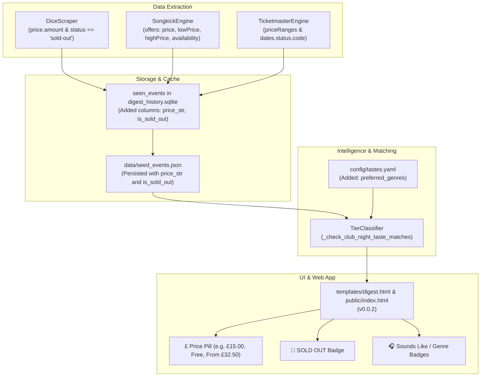

# Implementation Plan: Version Bump to v0.0.2, Club Night Taste Tagging & Ticket Price/Sold-Out Ingestion

> **Created:** 2026-11-03  
> **Workflow:** `/plan`  
> **Status:** Implemented  
> **Investigation Reference:** [`docs/explorations/versioning-clubnight-taste-tagging-ticket-pricing-soldout-20261103.md`](file:///Users/elliottcallender/Downloads/Live%20Curator/docs/explorations/versioning-clubnight-taste-tagging-ticket-pricing-soldout-20261103.md)  
> **ADR References:** [ADR-001](file:///Users/elliottcallender/Downloads/Live%20Curator/docs/decisions/001-engine-architecture-and-data-ingestion.md), [ADR-002](file:///Users/elliottcallender/Downloads/Live%20Curator/docs/decisions/002-ticketmaster-discovery-and-single-page-tier-cycling.md)

---

## 1. Summary

This plan addresses three core product enhancements requested for the Live Curator engine:
1. **Semantic Versioning Increment:** Bump the application version to `v0.0.2` across `src/__version__.py`, `src/core/models.py`, `templates/digest.html`, and `venues.html`.
2. **Club Night & DJ Taste Tagging:** Scan Club Night titles and descriptions against Elliott and Chloe's 1,200+ Spotify artists and a list of preferred musical genres (e.g. *Post-Punk, Indie Rock, Nu-Disco, Electronic, Shoegaze, Hyperpop, House, Techno*), prominently badging club nights with their musical alignment (`🎧 Plays Elliott's Favorite: Charli XCX`, `🎧 Genre: Post-Punk & Nu-Disco`).
3. **Ticket Prices & Sold-Out Availability Ingestion:** Extend the SQLite `seen_events` table and `data/seed_events.json` schema to preserve `price_str` and `is_sold_out`. Enhance DICE, Songkick, and Ticketmaster engines to capture ticket prices and sold-out/waiting-list flags and render them clearly in the UI (`🚫 SOLD OUT`, `£15.00`, `Free`).

---

## 2. Problem Statement

1. **Version Stagnation:** Despite major feature additions (multi-tier matching, venue expansion, client-side starring, and 680+ events), the web application still reports `v0.0.1`.
2. **Club Night Musical Blindspot:** Tier 4 (*Club Nights & DJs*) lumps all late-night events into a generic category (`Late Night Party (≥22:00)` or `Club / DJ Night`). London venues host dedicated artist tribute nights (e.g., Arctic Monkeys, Charli XCX, The Cure) and genre-specific dance events that match users' tastes, but these affinities are currently hidden.
3. **Missing Pricing & Sold-Out Data:** In `data/cache/digest_history.sqlite`, the `seen_events` table lacks columns for `price_str` and `is_sold_out`. When events were stored in history and reloaded by `scripts/build_pages.py`, prices were lost. Users cannot tell if a show costs £10 or £80, or if a high-demand show (like Keo at Brixton Academy) is already sold out.

---

## 3. Prior Solutions & References

```bash
./scripts/update-solution-ref.sh docs/explorations/archive/live-curator-engine-20261103.md docs/explorations/archive/preview-cap-versioning-clubnights-ticketmaster-20261103.md docs/explorations/archive/venue-expansion-ticketmaster-tier-cycling-20261103.md docs/explorations/systemic-pipeline-omissions-keo-and-artist-harvesting-20261103.md docs/explorations/versioning-clubnight-taste-tagging-ticket-pricing-soldout-20261103.md docs/explorations/why-fontaines-dc-missing-and-taste-mismatches-20261103.md docs/explorations/why-only-moth-club-33-shows-20261103.md docs/explorations/why-shows-zero-visible-20261103.md docs/explorations/why-tier1-tier2-empty-20261103.md docs/solutions/integration_issue/live-curator-engine-architecture.md
```

| Reference | Context |
|---|---|
| [`docs/explorations/versioning-clubnight-taste-tagging-ticket-pricing-soldout-20261103.md`](file:///Users/elliottcallender/Downloads/Live%20Curator/docs/explorations/versioning-clubnight-taste-tagging-ticket-pricing-soldout-20261103.md) | Exploration verifying Songkick AggregateOffer prices, DICE sold-out states, and club night taste scanning |
| [`docs/decisions/001-engine-architecture-and-data-ingestion.md`](file:///Users/elliottcallender/Downloads/Live%20Curator/docs/decisions/001-engine-architecture-and-data-ingestion.md) | Ingestion engine and data models |
| [`docs/decisions/002-ticketmaster-discovery-and-single-page-tier-cycling.md`](file:///Users/elliottcallender/Downloads/Live%20Curator/docs/decisions/002-ticketmaster-discovery-and-single-page-tier-cycling.md) | Single-page UI filtering & card layout |

---

## 4. Proposed Solution Architecture



---

## 5. Technical Specifications & Changes

### 5.1 Version Bumping
1. Update `src/__version__.py` to `"0.0.2"`.
2. Update `src/core/models.py` `MonthlyDigest.version` default to `"0.0.2"`.
3. In `templates/digest.html`: Display `v{{ version or '0.0.2' }}`.
4. In `src/ui/venue_manager.py`: Replace hardcoded `v0.0.1` with `{{VERSION}}` dynamic substitution.

### 5.2 SQLite Schema Migration & Cache Persistence
**File:** [`src/processing/event_diff_engine.py`](file:///Users/elliottcallender/Downloads/Live%20Curator/src/processing/event_diff_engine.py), [`scripts/build_pages.py`](file:///Users/elliottcallender/Downloads/Live%20Curator/scripts/build_pages.py)
1. Add columns to `seen_events` table if they do not exist:
   ```sql
   ALTER TABLE seen_events ADD COLUMN price_str TEXT;
   ALTER TABLE seen_events ADD COLUMN is_sold_out INTEGER DEFAULT 0;
   ```
2. Update `INSERT INTO seen_events` and `SELECT ... FROM seen_events` in `EventDiffEngine` and `scripts/build_pages.py` to write and read `price_str` and `is_sold_out`.
3. Ensure `data/seed_events.json` includes `price_str` and `is_sold_out` fields.

### 5.3 Ingestion Engines Extraction
1. **`src/ingestion/songkick_engine.py`:**
   - In `_extract_price`: support both single `offer.price` and `AggregateOffer` (`lowPrice`, `highPrice`, e.g. `From £32.50` or `£32.50 – £41.33`).
   - Extract `is_sold_out`: Check if `offers[].availability` contains `SoldOut`, or if title contains `(Sold Out)` or `[Sold Out]`.
2. **`src/ingestion/dice_scraper.py`:**
   - Extract `is_sold_out`: Check `event_data.get("status") in ["sold-out", "off-sale"]` or `event_data.get("waiting_list_enabled") == True` or `event_data.get("sale_state") == "sold_out"`.
3. **`src/ingestion/ticketmaster_engine.py`:**
   - Extract `is_sold_out`: Check `item.get("dates", {}).get("status", {}).get("code") in ["offsale", "cancelled", "soldout"]`.

### 5.4 Club Night Description & Genre Taste Matching
**File:** [`src/processing/tier_classifier.py`](file:///Users/elliottcallender/Downloads/Live%20Curator/src/processing/tier_classifier.py)
1. In `config/tastes.yaml` (and `tastes_schema`), define user-preferred genres:
   `["indie", "indie rock", "post-punk", "nu-disco", "electronic", "techno", "house", "shoegaze", "synthpop", "new wave", "hyperpop", "garage rock", "afrobeat", "jazz", "disco"]`.
2. In `TierClassifier._check_club_night_taste_matches(event)`:
   - Search `f"{event.title} {event.description or ''}"` using regex boundary matching (`\b{item}\b`).
   - For artists: Compare against Elliott's and Chloe's `all_direct_artists`.
   - If an artist is found, attach a rationale:
     - `MatchRationale(user="Elliott", description="🎧 Features Elliott's favorite artist: {artist}")`
     - `MatchRationale(user="Chloe", description="🎧 Features Chloe's favorite artist: {artist}")`
     - `MatchRationale(user="Mutual", description="🎧 Features your mutual artist: {artist}")`
   - If preferred genres are found:
     - `MatchRationale(user=None, description="🎧 Genre: {genre}")`

### 5.5 UI Rendering in `templates/digest.html`
1. **Sold-Out Badge:**
   ```html
   
   <span style="display: inline-block; background-color: #991b1b; color: #fee2e2; border: 1px solid #ef4444; font-size: 11px; font-weight: 800; padding: 3px 8px; border-radius: 4px; margin-right: 6px; margin-bottom: 4px;">
     🚫 SOLD OUT
   </span>
   
   ```
2. **Price Pill:**
   Display `event.price_str` prominently on cards across all tiers.
3. **Club Night Badges:**
   In the Club Nights section, display the `🎧` badges with distinctive neon purple / indigo styling.

---

## 6. Acceptance Criteria

- **Criterion 1:** The application version is bumped to `0.0.2` in `src/__version__.py`, `src/core/models.py`, `templates/digest.html`, `venues.html`, and generated pages.
- **Criterion 2:** SQLite `seen_events` table automatically migrates to include `price_str` and `is_sold_out` columns.
- **Criterion 3:** `data/seed_events.json` serializes and preserves `price_str` and `is_sold_out` across all events.
- **Criterion 4:** `SongkickEngine` correctly parses `AggregateOffer` pricing and sold-out availability flags.
- **Criterion 5:** `DiceScraper` and `TicketmasterEngine` correctly parse ticket prices and sold-out/waiting-list flags.
- **Criterion 6:** `TierClassifier` scans Club Night titles and descriptions for user artists and preferred genres, attaching descriptive `🎧` match rationales.
- **Criterion 7:** `templates/digest.html` displays sold-out badges (`🚫 SOLD OUT`), price pills (`£15.00`, `Free`), and club night taste badges.
- **Criterion 8:** All automated tests in `tests/` pass cleanly.
- **Criterion 9:** `./scripts/validate-compound.sh` confirms system health.
- **Criterion 10:** Static distribution is rebuilt and committed to `main`, successfully deploying to GitHub Pages.

---

## 7. Implementation Tasks

### Phase 1: Version Bumping
- **Task 1.1:** Bump version to `0.0.2` in `src/__version__.py` and `src/core/models.py`.
- **Task 1.2:** Update `templates/digest.html` and `src/ui/venue_manager.py` header version references.

### Phase 2: Schema Migration & Pipeline Pricing/Sold-Out Ingestion
- **Task 2.1:** Update `seen_events` table creation and migration in `src/processing/event_diff_engine.py` to add `price_str` and `is_sold_out`.
- **Task 2.2:** Update `scripts/build_pages.py` to select and persist `price_str` and `is_sold_out` into `data/seed_events.json`.
- **Task 2.3:** Enhance `src/ingestion/songkick_engine.py` to extract `AggregateOffer` prices and sold-out availability.
- **Task 2.4:** Enhance `src/ingestion/dice_scraper.py` and `src/ingestion/ticketmaster_engine.py` for sold-out status.

### Phase 3: Club Night Taste & Genre Flagging
- **Task 3.1:** Define preferred genres in `config/tastes.yaml` and `src/processing/tier_classifier.py`.
- **Task 3.2:** Implement `_check_club_night_taste_matches` in `TierClassifier` scanning titles and descriptions for user artists and genres.
- **Task 3.3:** Add unit tests for club night taste matching and pricing/sold-out extraction.

### Phase 4: UI & Template Badging
- **Task 4.1:** Update `templates/digest.html` to render sold-out badges, price pills, and club night taste badges across all event cards.
- **Task 4.2:** Update `venues.html` version display.

### Phase 5: Re-harvest, Verification & Deployment
- **Task 5.1:** Re-harvest events, update SQLite cache with prices and sold-out flags, and regenerate static distribution via `scripts/build_pages.py`.
- **Task 5.2:** Run full test suite (`pytest tests/ -v`).
- **Task 5.3:** Validate compound system (`./scripts/validate-compound.sh`).
- **Task 5.4:** Commit and push to `origin/main` for GitHub Pages deployment.
