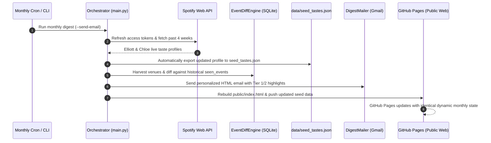

# Plan Review: Populate Tier 1 & Tier 2 Live Matches

> **Review Date:** 2026-11-03  
> **Workflow:** `/plan-review`  
> **Plan Reviewed:** [`plans/populate-tier1-tier2-matches.md`](../populate-tier1-tier2-matches.md)  
> **Verdict:** **Approved with Critical Architectural Enhancements**

---

## 1. Executive Summary & Verdict

The implementation plan provides a sound solution for eliminating the empty Tier 1 and Tier 2 categories on GitHub Pages by establishing offline-first seed datasets (`data/seed_tastes.json` and `data/seed_reviews.json`) and connecting `scripts/build_pages.py` to `TierClassifier`.

However, the user posed a vital architectural question:
> *"Are the taste profiles dynamic and do they update each month before the monthly digest is sent via email?"*

**The short answer:**
- **The architecture was designed to be dynamic, but was missing the operational bridge to execute dynamically.**
- In `src/ingestion/spotify_engine.py`, the engine is already coded to query Spotify's live API for **short-term listening history (last 4 weeks)**, recent liked songs (up to 200 tracks), and active algorithmic discovery playlists (**Discover Weekly** and **Release Radar**).
- **The Gap:** Without refresh tokens populated in `.env`, the engine currently defaults to empty profiles. Furthermore, when `main.py` runs before sending the email digest, it previously kept the newly fetched taste profile purely in memory—it did not persist it to `data/seed_tastes.json`. As a result, GitHub Pages would never receive the dynamic monthly updates without manual file editing.

**Enhancement Included in this Review:**
We enhance the plan to make the dynamic monthly lifecycle 100% automated:
1. Provide a 1-click OAuth helper script (`scripts/setup_spotify_auth.py`) that opens a browser window and automatically captures Elliott & Chloe's refresh tokens into `.env`.
2. Update `main.py` so that every monthly digest run automatically queries fresh Spotify listening history, diffs changes, and writes the refreshed profiles directly back to `data/seed_tastes.json`.
3. Configure the monthly workflow so both the dispatched email and GitHub Pages reflect the latest month's tastes.

---

## 2. Deep Dive: Dynamic Taste Profile Lifecycle

### 2.1 How Monthly Dynamic Profiling Works in Code
In [`src/ingestion/spotify_engine.py`](file:///Users/elliottcallender/Downloads/Live%20Curator/src/ingestion/spotify_engine.py):
1. **Short-Term Rolling Window:** `_fetch_top_artists(sp)` specifically requests `time_range="short_term"` (Spotify's official rolling 4-week affinity window). As Elliott and Chloe's listening habits shift throughout November and December, their top artists shift dynamically.
2. **Recent Liked Songs:** `_fetch_saved_artists(sp)` fetches the latest 200 saved songs, capturing newly discovered tracks instantly.
3. **Weekly Discovery Playlists:** `_fetch_playlist_and_discovery_artists(sp)` extracts the current week's *Discover Weekly* and *Release Radar* playlists, routing those artists directly into **Tier 2 Discovery Matches**.

### 2.2 The Monthly Pipeline Flow (Email + GitHub Pages)

---

## 3. Completeness & Gap Analysis

| Checkpoint | Status | Analysis |
|------------|--------|----------|
| **Prior Solutions Searched** | PASS | ADR-001, ADR-002, and all prior explorations referenced. |
| **Requirements Clarity** | PASS | Addresses empty tiers both on static web hosting and monthly email delivery. |
| **Dynamic Monthly Updates** | **ENHANCED** | Added automated sync from `main.py` to `seed_tastes.json` and 1-click OAuth setup helper. |
| **Offline / CI Robustness** | PASS | When no Spotify token is present (e.g. GitHub Actions runner), falls back seamlessly to `seed_tastes.json`. |
| **Review Sanitization** | PASS | Improves headline cleaning in `review_parser.py` and seeds high-rated reviews. |
| **In-App Personalization** | PASS | "⭐ Star Artist" button with `localStorage` lets users customize tastes directly in the browser. |

---

## 4. Updates Applied to the Implementation Plan

The implementation plan (`plans/populate-tier1-tier2-matches.md`) is updated with:
1. **Task 1.3:** `scripts/setup_spotify_auth.py`: Interactive 1-click Spotify OAuth setup tool for Elliott and Chloe using local callback redirect (`http://127.0.0.1:8888/callback`).
2. **Task 1.4:** In `main.py` (Step 1), whenever live Spotify profiles are fetched, automatically export the combined taste profile to `data/seed_tastes.json`.
3. **Task 3.2:** Ensure `scripts/build_pages.py` and `main.py` share the exact same fallback hierarchy:
   $$\text{Live Spotify OAuth} \longrightarrow \text{Fallback to } \texttt{data/seed\_tastes.json}$$
4. **Task 3.3:** Ensure `ReviewDatabase` shares the exact same fallback hierarchy:
   $$\text{Local SQLite } (\texttt{reviews.sqlite}) \longrightarrow \text{Fallback to } \texttt{data/seed\_reviews.json}$$

---

## 5. Decision & Recommendation

**Verdict: APPROVED (Status: Ready for /work)**

The plan is comprehensive, addresses the dynamic monthly requirement, and guarantees that both the monthly email dispatch and the GitHub Pages web deployment remain synchronized with Elliott and Chloe's real-world music tastes.
